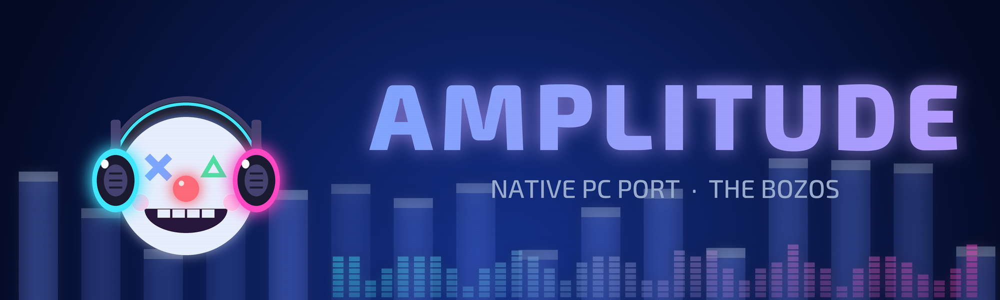

<div align="center">



# Amplitude_Recomp

**A native PC port of *Amplitude* (NTSC-U, `SCUS-97258`), made by statically recompiling the game's PlayStation 2 code to C++. Windows first; Linux later.**<br>
Built on [BozoEngine](https://github.com/TheBozos/BozoEngine), The Bozos' own toolchain: the game's EE code recompiled to C++, every library and kernel call it makes answered by native code. No PS2 hardware model at any level: no GS, VU, VIF/GIF, DMA, IOP or SPU2.

-1b8cff)


</div>

> [!IMPORTANT]
> No game files are included: no ELF, IRX modules, archives, audio streams, or code generated from them.
> You need **your own copy** of the North American release, PS2 ID **`SCUS-97258`** (disc version 1.00). The port is
> built against that disc's executable:
>
> | File | SHA-1 |
> |---|---|
> | `SCUS_972.58` | `3a2e05f454ae36abc85da31225bc6968d8fb5548` |

## Status

**Bring-up.** The whole executable recompiles and links into a native program. A headless run boots through the SDK set-up to the first frame and stops at the game's own display set-up; nothing is drawn yet.

| Milestone | |
|---|:---:|
| Disc layout, executable sections and IOP modules mapped | ✅ |
| Whole program recompiled by bozo-recomp: 13,651 functions, no untranslated instruction | ✅ |
| Library symbol map for the stripped executable (493 names, 178 of the engine's natively answered calls) | 🔧 |
| Port build (`amp-headless`, `amplitude`) linked against BozoEngine | ✅ |
| Boot to the first frame | ✅ |
| Native display and drawing | 🔧 |
| Menus, song select, `MAIN.ARK` data and native rendering | ⏳ |
| Multitrack song streaming and Harmonix's synth on the native mixer | ⏳ |
| A complete song playable, beat-matching in time | ⏳ |
| Memory-card saves, multitap (four players) | ⏳ |
| Linux build | ⏳ |

✅ works · 🔧 in progress · ⏳ not reached yet

Online play (the network GUI and stack on the disc) is out of scope: its servers are long gone.

[docs/RECOMP_NOTES.md](docs/RECOMP_NOTES.md) records the disc, the executable and every step of the bring-up.

## Goal

A fully playable *Amplitude* as a native PC program: every song, mode and remix, drawing and playing sound directly
from the game's data, with tight audio/input timing first. Widescreen, higher resolutions and other presentation
options follow.

## How it works

```
disc files (game/) ──► scripts/symbols.sh ──► recomp/amp_symbols.txt (library names for the stripped ELF)
                                   │
          BozoEngine's bozo-recomp ──► native C++ in build/ (never committed)
                                   │
            CMakeLists.txt ──► BozoEngine + generated code + Amplitude's own adapters ──► amplitude.exe
```

- `SCUS_972.58` is a stripped GCC build using Sony SDK 2.6 libraries. BozoEngine discovers the functions from the code
  itself; `bozo_symbolmap.py` names the SDK functions by matching them against executables that keep their symbols.
- Game data lives in `GEN/MAIN.ARK`, a Harmonix ARK archive; each song is a multitrack stream in `AUDIO/*.STR`.
- Game-specific addresses, formats and hooks stay in this repository; engine changes go to BozoEngine and stay generic.

## Requirements

- Windows 10/11 with [MSYS2](https://www.msys2.org/) (UCRT64); Linux is not qualified yet
- CMake 3.21+, Ninja, GCC with C++20 support
- `bsdtar` (libarchive) to extract the disc, Python 3
- Your own copy of `SCUS-97258` (check the hash above)

```bash
pacman -S --needed mingw-w64-ucrt-x86_64-{gcc,cmake,ninja,pkgconf,libarchive,python} git
```

## Build and run

A headless run reaches the first frame; nothing is drawn yet. This is the developer workflow as it stands.

```bash
git clone --recurse-submodules https://github.com/TheBozos/Amplitude_Recomp.git
cd Amplitude_Recomp
scripts/extract_iso.sh "/path/to/Amplitude (USA).iso"
scripts/symbols.sh <reference ELFs with symbols>...   # only when the symbol map changes
scripts/bench_run.sh --alone 30 "build" scripts/build_runtime.sh
PS2X_PAD_NO_HOST=1 scripts/bench_run.sh 10 "boot" scripts/run.sh --frames 600
```

`scripts/run.sh` runs `amp-headless`; `AMP_WINDOW_RUN=1` runs the `amplitude` window instead (`--hidden`, `--mute`
for unattended runs). The runner prints where the game stops and what is not native yet.

Builds and timed runs take the shared benchmark lock alone (`scripts/bench_run.sh --alone`); game runs take one slot.

## Disc facts

- `SYSTEM.CNF`: `BOOT2 = cdrom0:\SCUS_972.58;1`, `VER = 1.00`, `VMODE = NTSC`.
- `SCUS_972.58`: one program header `0x100000`..`0x449898`, entry `0x100010`, stripped (no `.symtab`, no DWARF),
  GCC with C++ exceptions, Sony SDK 2.6 libraries. A few routines live inside `.rodata`.
- `GEN/MAIN.ARK` (564 MB, ARK version 2, 4,526 entries), 26 song streams in `AUDIO/`, IOP modules in `IOP/`
  (including Harmonix's `SYNTH_S.IRX` and `SOFTFX_S.IRX`), the online setup GUI in `NETGUI/`.

## Repository layout

| Path | What |
|---|---|
| `BozoEngine/` | The engine (submodule): recompiler, runtime, native libraries, tools |
| `recomp/` | The symbol map and the names read by hand |
| `runtime/` | The runner (`amp_main.cpp`) and the port's native overrides (`amp_port.cpp`) |
| `tools/` | `amp_prepare.py` (the ELF as bozo-recomp reads it), the naming aids (`amp_disasm.py`, `amp_callers.py`, `amp_rpc_names.py`) |
| `runtime/app/` | The window build's icon, manifest and Windows resources |
| `scripts/` | Disc extraction, symbol map, build, run, shared bench lock |
| `docs/` | [RECOMP_NOTES.md](docs/RECOMP_NOTES.md), the branding (`docs/branding/make_logo.py`) |

## Credits

- **The Bozos**: boubou666 and Arzaroth, who make this port and BozoEngine
  ([RecompWatcher](https://thebozos.github.io/RecompWatcher/) shows our projects).
- [BozoEngine](https://github.com/TheBozos/BozoEngine), The Bozos' MIT recompiler and native runtime.
- The team's other recompilations (*Dark Cloud*, *Twisted Metal: Black*, *Onimusha: Warlords*, *Shinobido*, *The Lord
  of the Rings: The Third Age*, *Valkyrie Profile 2: Silmeria*, *Jade Cocoon 2*), which share native development work.
- *Amplitude* © Sony Computer Entertainment America, developed by Harmonix Music Systems. This is an unofficial fan
  project, not affiliated with or endorsed by them.

## Licence

MIT, see [LICENSE](LICENSE). Game data is never part of this repository: the port builds from the player's own disc.
